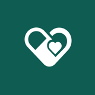
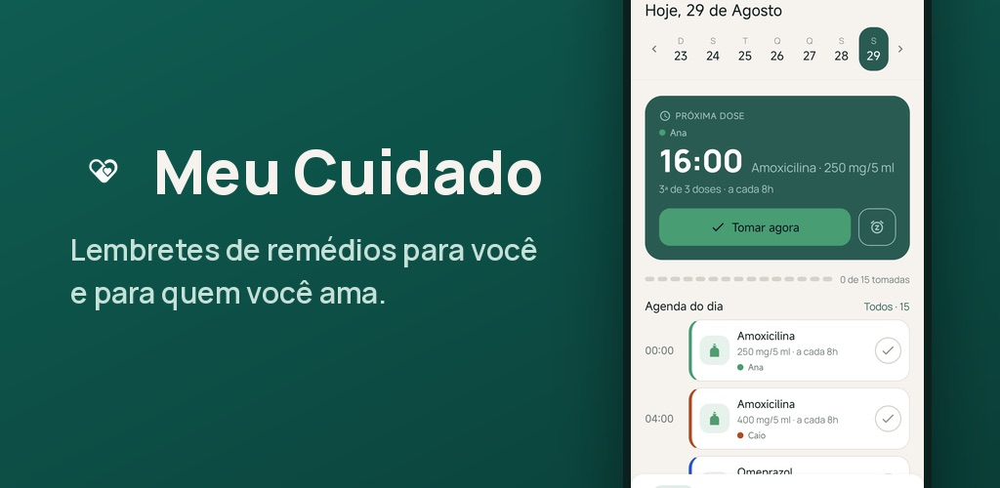
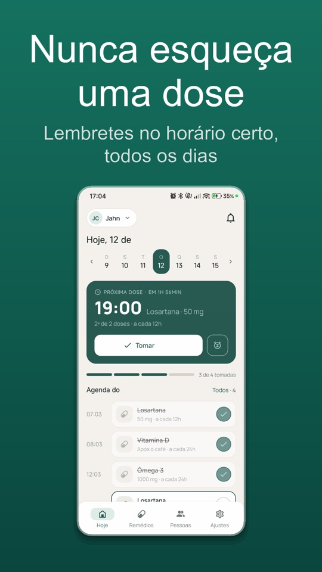
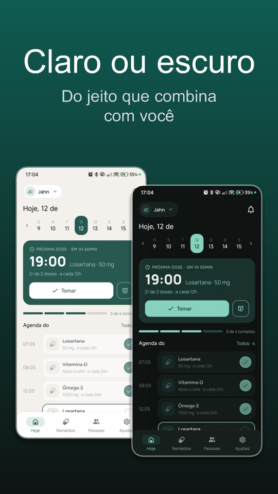
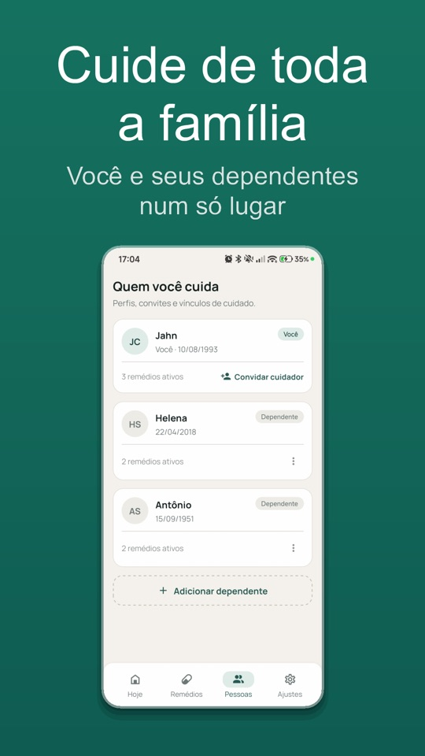
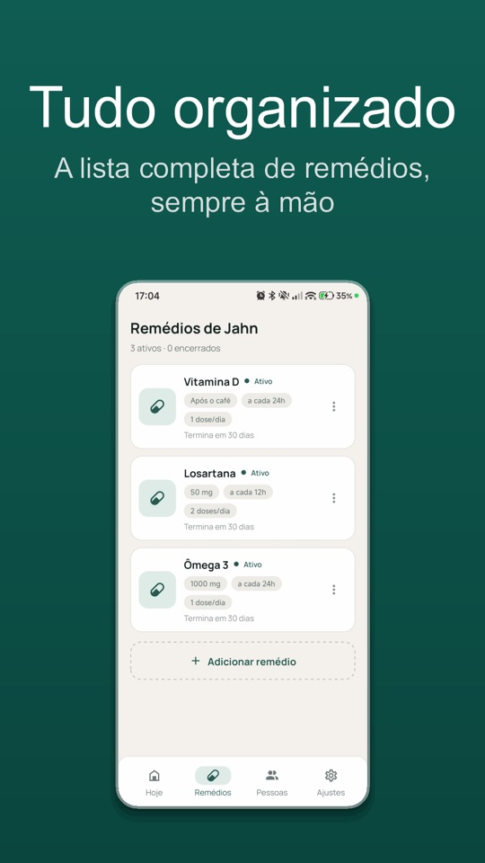
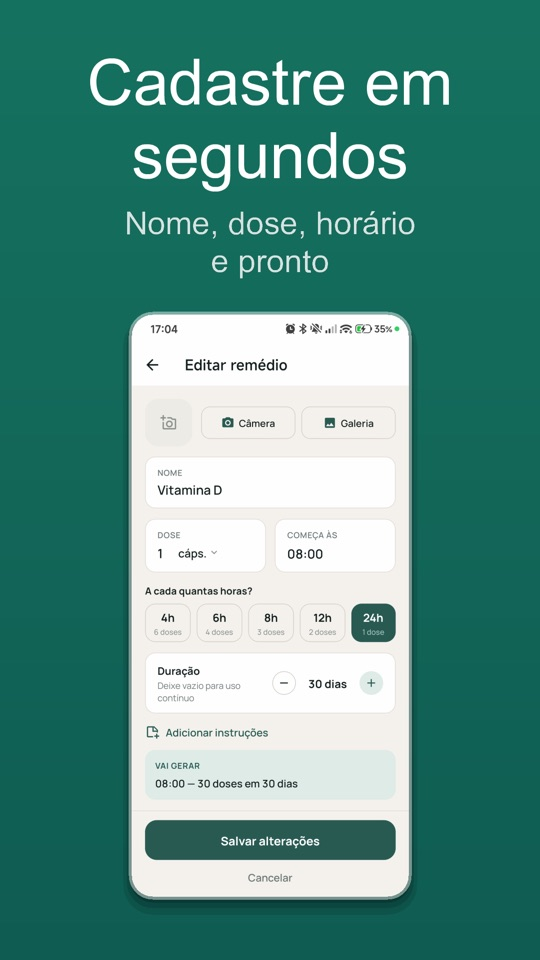
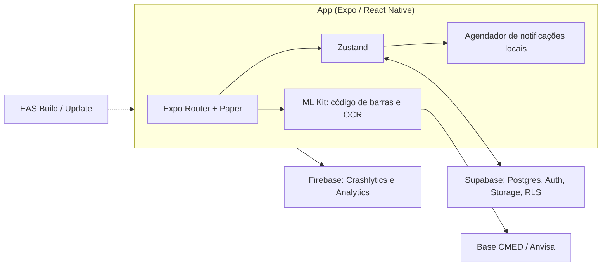

<h1 align="center">Meu Cuidado</h1>

App de lembretes de remédio para você e para as pessoas de quem você cuida.

  
  

## Sobre

Você cadastra os seus remédios e os dos seus dependentes (filhos, pais, avós), e o app avisa no horário de cada dose. A notificação tem os botões Tomei, Adiar e Pular, então dá para registrar a dose sem abrir o app.

Outra pessoa pode cuidar junto: ela recebe um convite por link e passa a acompanhar o mesmo dependente. Para cadastrar um remédio, você aponta a câmera para o código de barras ou fotografa o rótulo, e o app busca o produto na base de medicamentos da Anvisa (CMED).

## Telas

| | | | | |
|:-:|:-:|:-:|:-:|:-:|
|  |  |  |  |  |

## Como foi feito

- O app confere as notificações que o sistema operacional realmente tem agendadas antes de cancelar ou reagendar, porque um cache local pode ficar desatualizado. Ele também respeita o limite de agendamentos do Android e usa o canal de prioridade máxima.
- Adiar roda em segundo plano. Tomei e Pular abrem o app para gravar a dose com o usuário autenticado.
- A leitura de código de barras e o OCR do rótulo rodam no aparelho com ML Kit e funcionam offline. A foto não é enviada a nenhum servidor.
- Convites e vínculos entre cuidadores passam por funções no Postgres com RLS, e cada pessoa só enxerga os dependentes que cuida.
- A telemetria não recebe dados de saúde nem o texto lido nos rótulos.
- Há testes com Jest e Testing Library, fluxos E2E em Maestro e atualizações OTA pelo EAS Update.

## Arquitetura

## Stack

Expo SDK 55 · React Native 0.83 · React 19 · TypeScript · Expo Router · React Native Paper · Reanimated 4 · Zustand · Supabase · expo-notifications · ML Kit · Firebase · Jest · Maestro · EAS

## Meu papel

Fiz o produto, o design, o app, o backend e a publicação nas lojas.

O código-fonte é privado. Para ver uma demo ou conversar sobre o projeto, fale comigo em <a href="https://abisay.tech">abisay.tech</a> ou no <a href="https://www.linkedin.com/in/jahncarlos">LinkedIn</a>.
